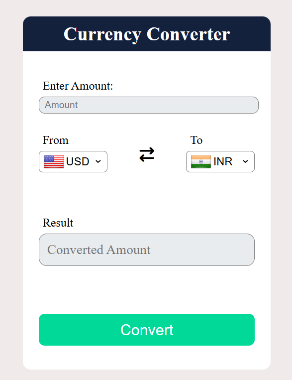

# Currency Converter

A simple and interactive Currency Converter web application built using **HTML, CSS, and JavaScript**. It allows users to convert an amount from one currency to another using the latest available exchange rates fetched from an API.

## Features

- Convert between multiple currencies.
- Fetch exchange rates using a currency exchange API.
- Display country flags alongside currency options.
- Automatically update exchange rates when currencies are changed.
- Validate the amount entered by the user.
- Clean and user-friendly interface.
- Responsive design for different screen sizes.

## Technologies Used

- **HTML5** – Structure of the application.
- **CSS3** – Styling and responsive layout.
- **JavaScript** – Application logic, DOM manipulation, and API integration.
- **Currency API** – To fetch exchange rate data.
- **Flags API** – To display country flags.

## Project Preview

.

## Project Structure

```text
currency-converter/
│
├── index.html
├── style.css
├── Codes.js
├── script.js
└── README.md
```

## APIs Used

- [Currency API](https://github.com/fawazahmed0/exchange-api) – Provides exchange rate data.
- [Flags API](https://flagsapi.com/) – Provides country flag images.

## What I Learned

While building this project, I practised:

- JavaScript DOM manipulation.
- Working with JavaScript events.
- Fetching API data using `fetch()`.
- Using asynchronous JavaScript with `async/await`.
- Handling API responses and errors.
- Working with dropdown menus and dynamic content.
- Updating the UI based on user interactions.

## Author

**Tanisha**

GitHub: [@tanishab07](https://github.com/tanishab07)

---

⭐ If you find this project useful, feel free to explore it!